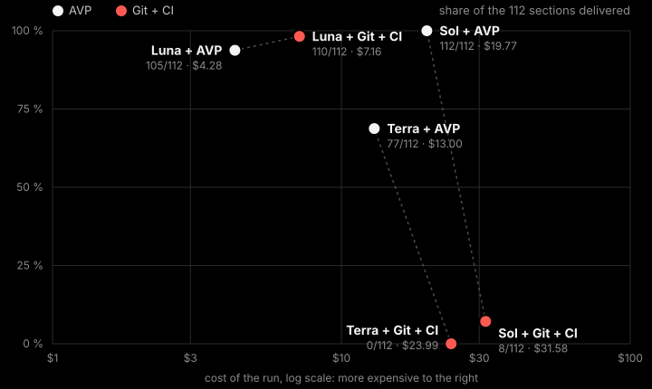

# Many agents, one main: the benchmark

Run on 29 and 30 October 2026. Only version control changes between the two arms.

## The setup

- **The project.** Facturo, a billing API in TypeScript, written from a spec cut into sections
  (about 1.75 per agent: 112 sections for 64 agents). Each section has its own acceptance tests.
  `many-agents/gen.py` generates the spec, the tests and the base repository for a team size.
- **The agents.** Codex (`codex exec`), every agent on its own sections, all at the same time,
  delivering to one shared main. Every agent gets the same instructions; only the paragraph about
  version control differs: `many-agents/vcs-gitci.md`, `vcs-ghmq.md`, `vcs-avp.md`.
- **Git + CI.** Each agent has its own clone. main is protected by CI, as on GitHub: a push to main
  runs, in a fresh folder, the install, the typecheck and every test on the exact commit it would
  make main, and is refused when they fail.
- **Git + GitHub merge queue.** A real private GitHub repository: pull requests, CI on GitHub
  Actions (runners on the same machine), merged by GitHub's merge queue with its default settings,
  except the wait before merging, set to zero.
- **AVP.** Each agent has its own view; every landing is proven on the head of the line.
- **Delivered.** A section counts when its original acceptance tests pass on main. After each
  round, the sections not done go back to their agents, told which, the same way in every arm;
  five rounds at most. At 64 agents, every team gets the same 40-minute window.
- **Cost.** The tokens of every session, at the public API price of the model.

## 64 agents, 40 minutes (96-CPU machine)

| | Git + CI | AVP |
|---|---|---|
| GPT-6.1 Sol (medium effort) | 8 of 112, $31.58, stopped at 40 min | **all 112 in 10 min 24 s**, $19.77 |
| GPT-6.1 Terra (medium effort) | 0 of 112, $23.99, stopped at 40 min | **77 of 112**, $13.00 |
| GPT-5.6 Luna (low effort) | 110 of 112 in 24 min, $7.16 | 105 of 112 in 26 min, **$4.28** |

main was never red, in any run. The sections depend on each other: the acceptance tests of
Customers need Invoices, and those of Invoices need Customers. With Git and CI, each push is red
without the other's work, CI refuses both, and Sol and Terra wait for a teammate who waits for
them (Terra: 22 CI runs, all red). AVP sees the cycle and lands the two tasks together, proven as
one change (`avp land --with`). Luna writes the missing code itself and gets through with Git too;
with AVP it costs 40 % less, with 42 % fewer tokens.

## 32 agents, Luna (32-CPU machine)

| | Sections of 56 | Cost per run | Tokens | Time |
|---|---|---|---|---|
| **AVP**, 3 runs | 56, 52, 56 | $1.23, $1.97, $1.97 | 33, 53, 55 M | 8, 22, 16 min |
| Git + CI, 3 runs | 56, 53, 56 | $2.94, $3.21, $2.88 | 84, 91, 81 M | 17, 16, 14 min |
| Git + GitHub merge queue, 2 runs | 34, 32 | $3.85, $4.13 | 109, 124 M | 32, 38 min |

In the merge queue runs, 43 pull requests a run, 20 to 21 merged, about 220 CI runs a run.
Pull requests the queue turned down for a conflict or a red check rarely came back, and a tenth
of the agents' commands were `sleep`, waiting for the queue.

16 agents, Luna, one run each: AVP 26 of 28 in 12 min for $0.81; Git + CI 25 of 28 in 13.5 min
for $1.22.

## Where the time goes

On the 64-agent Git run with Luna, 3,773 of the agents' 4,994 commands were version control
(pulls and rebases 45 %, pushes 11 %, the rest 19 %), and 320 of 557 pushes were refused. CI
itself, 393 runs of about 10 seconds, was about 4 % of the agents' time. With AVP, 38 % of the
commands were code and 16 % tests.

## What to keep in mind

- CI takes seconds here; a real one takes minutes, which would widen the gaps.
- One run per point at 64 agents; three at 32, where runs vary (8 to 22 minutes for AVP).
- The AVP runs used the line at positions 97 (Sol, Terra, 32 and 16 agents) and 98 (Luna, 64).

## Running it again

`many-agents/run-done.sh <avp|gitci|ghmq> <agents>` runs one team from a base built by `gen.py`;
`analyse-done.py <run>` prints what it delivered, its tokens and its cost. The scripts expect a
Linux machine with Node, pnpm, Codex and `avp`, and keep their state under `~/.ctx-bench`.
