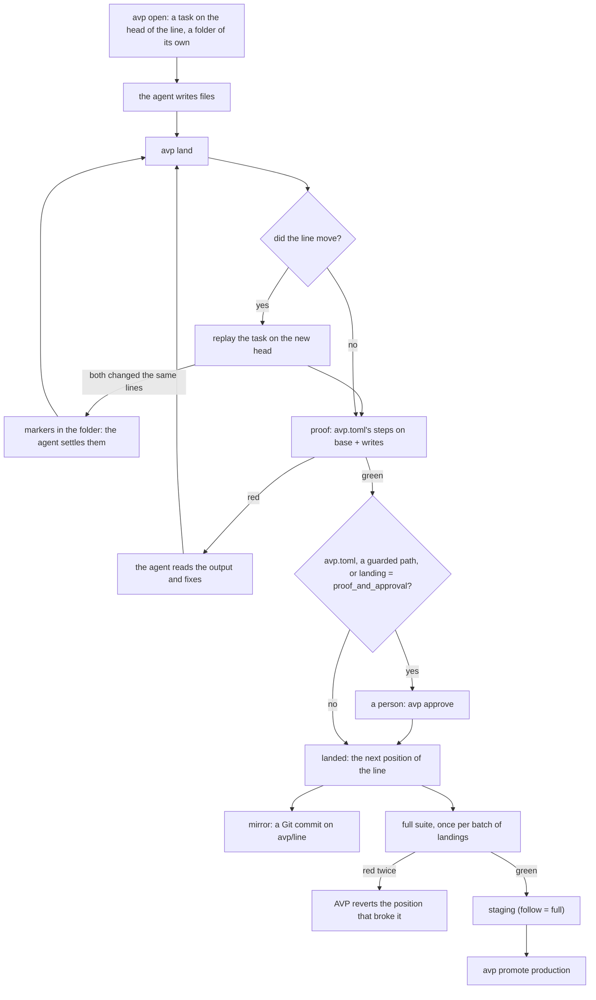

# AVP concepts

The words AVP uses, a task's life from open to production, and what each replaces in Git and
GitHub. To try it first: [Your first 15 minutes](QUICKSTART.md).

## The words

**Line.** The ordered list of what landed on a repo: one line per repo, no branches. It takes the
place of `main` and of every branch beside it.

**Position.** A numbered point on the line: position 0 is where it starts (a commit imported from
Git, or `avp init`), and each landing adds one. A position is an exact tree of files, as a commit
is, and `avp show <position>` prints what it changed.

**Task.** One change with a one-line goal, made by an agent for a person, from `avp open` (or
`avp_open`) to `avp land`. It holds the files it wrote on top of the position it was opened on, its
base, and nothing else.

**View.** The folder a task is laid out in: the files of its base, then its own writes. `avp up`
gives each agent one of its own under `~/avp/<repo>-<n>`. What the agent saves there is sent to the
server as the task's writes: the folder is a copy, the server holds the truth.

**Lease.** A task's hold on a path, taken by its scope at `avp open` or by its first write there, and
let go when it lands, is abandoned, or writes nothing for 10 minutes. By default a lease informs, it
does not lock: another task may still write the path and takes the lease over, and the first one is
told (a repo created with `--policy strict` refuses the write instead).

**Proof.** The check of a task's tree, its base plus its writes, by the steps of the line's
`avp.toml`: usually the typecheck and the tests related to the files it changed, in seconds. It
records the base, each step and its output, and a verdict: green, red, or blocked (a failing file
another task holds).

**Landing.** A task becoming the next position of the line, only with a green proof on the exact
head. When the line moved since the task opened, AVP first replays the task on the new head, and
proves it again when what landed meanwhile touches what its proof covered.

**Full suite.** The whole test suite (`full` or `[[check.full_shards]]` in `avp.toml`), run after
landings, never before one. It runs once per batch, on the newest position; red twice, AVP finds
the position that broke it and reverts it in a task of its own.

**Mirror.** The process that writes each new position as a Git commit on a branch (`avp/line` by
default), fast-forward only, and pushes it when the checkout has a remote. Git, GitHub and your
deploys keep working while a team moves over; `avp up` starts one.

**Environment.** A name such as staging or production that points at the position it serves.
Each is set in `avp.toml` under `[envs.<name>]`, with the deploy that makes it serve a position: a
GitHub workflow, a command AVP runs, or none.

**Promotion.** Moving an environment to a position: `avp promote <env> [position]`, or AVP itself
for an environment with `follow = "full"`. It needs a green full suite on that position (`--force`
skips it), and what `after` and `approvers` ask; `avp rollback <env>` takes it back.

## A task's life

## What replaces what

| Git and GitHub | AVP |
|---|---|
| `main` | The line. |
| A branch | A task: minutes long, one goal, closed by its landing or `avp abandon`. |
| A commit | A write: a file the task saved, sent to the server. The landing makes the position, which the mirror writes as one commit. |
| A pull request | The task with its proof, read with `avp show` and `avp why`. A person says yes with `avp approve` where the repo asks for one (`avp landing proof_and_approval`, `avp guard <path>`). |
| CI on each pull request | The proof: the steps of `avp.toml` on the exact head, the typecheck and related tests, in seconds. The whole suite runs after landings, once per batch. |
| A merge queue | The landing: one task at a time, proven on the exact head it lands on. What its related tests miss, the next full suite catches. |
| Rebase and merge | The replay: AVP replays the task on the head. Only a change to the same lines of the same file ends in markers, for the agent. |
| `git log`, `git blame` | `avp log`, `avp blame`, and `avp why <file>:<line>`: the task, its goal, its agent, its proof. |
| `git revert` | `avp revert <position>`: a task that takes the change back, proven like any other. |
| A tag deployed somewhere | An environment: `avp envs` says which position each serves. |
